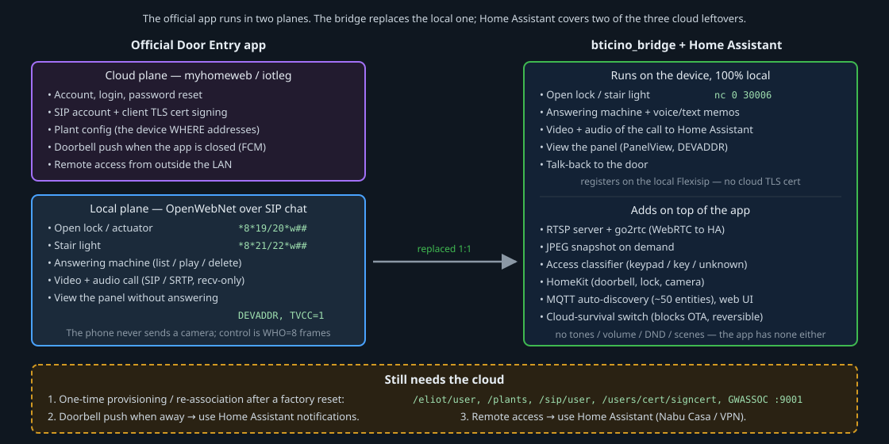

# App versus bridge: can you drop the official app?

This page compares the official **Door Entry CLASSE300X** app
(`com.legrandgroup.c300x`, analysed at v1.17.3) with the **bridge** in this
repository, so you know what you keep and what you lose if you run the device
from Home Assistant instead of the app.

## The app is smaller than it looks

The app is strictly a **video door entry client**: lock, stair light, answering
machine, video/audio calls, external CCTV (TVCC) and an optional Netatmo menu.
It has **no** ringtone, volume, do-not-disturb, "professional studio", language,
clock, scene, automation (lighting/automation buses), still-photo or RTSP
features. If you expected those, they were never in the app.

It works in two planes:

- **Cloud plane** — account, SIP provisioning, client-certificate signing, plant
  configuration and push, over HTTPS to `myhomeweb.com` and SIP/TLS to
  `*.bs.iotleg.com`.
- **Local plane** — control commands (lock, light, answering machine) ride as
  OpenWebNet frames inside SIP chat messages on the registered session; video
  and audio are SIP/SRTP. The phone never sends a camera.

## What the bridge replaces

| Capability | App mechanism | Bridge |
|------------|---------------|--------|
| Open lock / actuator | `*8*19/20*<where>##` | yes (sends to localhost `:30006`) |
| Stair light | `*8*21/22*<where>##` | yes |
| Answering machine: status, list, play, delete, welcome flag | `*8*91/92##`, `*13*35*##` | yes — plus voice/text memos |
| Video + audio of the call | SIP/SRTP, recv-only | yes — passive loopback tap to go2rtc |
| View the panel without answering | Call Home with `DEVADDR` | yes (PanelView) |
| Talk-back to the door | SIP send/recv | yes (one-shot via the native greeting; full duplex is gated) |
| JPEG snapshot | not exposed by the app | **added** |
| RTSP / WebRTC to Home Assistant | not in the app | **added** |
| Access classifier (keypad / key / unknown) | not in the app | **added** |
| HomeKit, MQTT auto-discovery, web dashboard | not in the app | **added** |

The bridge registers against the **local Flexisip**, so it does **not** need the
cloud-signed TLS certificate the app uses. See
[the bridge](../bticino_bridge/README.md) and the
[bridge architecture diagram](diagrams/04-bridge-architecture.svg).

## What still needs the cloud

1. **One-time provisioning / re-association.** Creating the account, provisioning
   the SIP user, signing the client TLS certificate, downloading the plant
   configuration (which holds the device `WHERE` addresses), and the local
   `ACT GWASSOC` step that writes the cloud-issued `SEC_TOKEN` into the device's
   `pwd_open`. You only need this once; you need it again only after a factory
   reset or after untying the last user ("clear plant"), which resets `pwd_open`
   to the factory default. Reproducing it without the app is a separate
   reverse-engineering target — see [Re-provisioning](#re-provisioning-reference).
2. **Doorbell push when the app is closed** relied on Firebase (FCM). With the
   bridge you get the ring as a Home Assistant event and let **Home Assistant**
   send the push.
3. **Remote access** from outside the LAN was SIP/TLS through the cloud. Use
   **Home Assistant** remote access instead (Nabu Casa, a VPN or a reverse proxy).

## Re-provisioning (reference)

For completeness, the cloud endpoints the app uses to provision an installation
(from decompilation; all HTTPS to the portal host):

- `POST /eliot/user` — account (also `GET`/`PUT`/`DELETE`, `POST /eliot/user/pwd-reset`).
- `POST /eliot/plants`, `POST /eliot/plants/{id}/gateway` — create and associate
  the installation; `GET /eliot/plants/{id}/gateway/{gw}/conf` returns the
  `conf.xml` with the `WHERE` addresses.
- `POST /eliot/sip/user` — provision the SIP account;
  `GET /eliot/sip/users/plants/{plant}/gateway/{gw}` reads the credentials.
- `POST /eliot/users/cert/signcert` — the phone generates a key pair and the
  cloud signs the client certificate.
- Local step: `ACT GWASSOC` on OpenWebNet port **9001** writes the cloud-issued
  `SEC_TOKEN` into `<sicurezza><pwd_open>`. The factory default is `12345`.

Discovery and model/MAC reads are local: scan port `20000` with the HMAC
handshake, read the model with `*#1013**1` and the MAC with `*#13**12`.

## Notes

- **Answering-machine polarity.** On the device, `*8*91##` enables and `*8*92##`
  disables the answering machine, but those frames **alone** do not flip the
  stored state — the effective toggle is the dimension-40 frame
  `*#8**40*1*0*9815*1*25##` (with the display turned on first). The read-only
  status query is `*#8**40##` → `*#8**40*VM*WM*...##`.
- **Lock `WHERE`.** The app derives the lock `WHERE` from the plant
  configuration; a fixed bridge configuration must match your installation's
  address.
